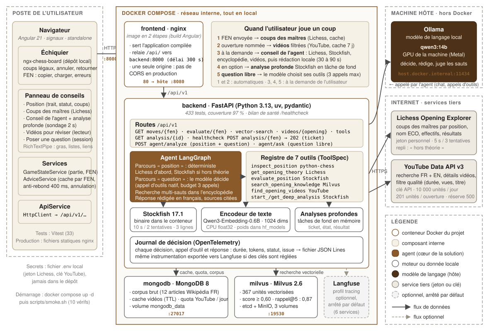
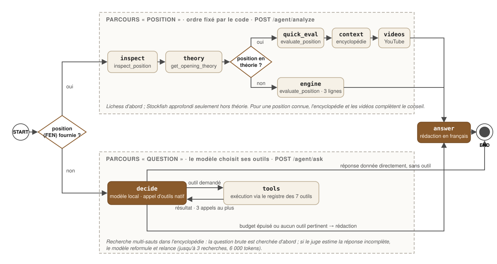

<!-- kicker: Schéma d'architecture · application livrée -->
# Coach d'ouvertures : architecture de l'application

**Schéma d'architecture, composants, flux, graphe de l'agent, données, ports et configuration
de la solution livrée**

| | |
|---|---|
| Destinataires | jury, équipe technique FFE, toute personne qui reprend le projet |
| Version décrite | branche `main`, 23 octobre 2026 |
| Lecture | 2 schémas en pages paysage (ensemble, graphe de l'agent) et 5 tableaux ; version « schémas seuls » : `docs/architecture-schemas.pdf` |
| Documents de détail | `docs/fonctionnalites.md` (guide de A à Z), `docs/deploiement.md`, `docs/contrat-tools.md`, `docs/outil-rag.md`, `docs/outil-videos.md`, `docs/frontend.md` |

---

## Résumé

L'application tient en **quatre zones** : le navigateur de l'utilisateur (Angular), une pile
Docker Compose entièrement locale (nginx, FastAPI avec l'agent et ses outils, MongoDB,
Milvus), le modèle de langage servi par **Ollama sur la machine hôte** pour profiter du GPU,
et deux **services tiers** interrogés par HTTPS (Lichess, YouTube). Le cœur est un **agent
LangGraph** qui, selon qu'on lui donne une position ou une question, suit un parcours
déterministe ou choisit ses outils parmi un registre de sept. Tout ce qui est produit par
l'agent est journalisé (décisions, appels, durées, tokens) ; l'export vers Langfuse reste
optionnel.

## 1. Schéma d'ensemble

Le schéma ci-après se lit de gauche à droite : l'utilisateur, la pile Docker, puis ce qui
est hors de Docker (modèle local, Internet). Les flèches pleines sont des flux de données
réels ; les flèches pointillées sont optionnelles. Les ports indiqués sont ceux exposés sur
la machine hôte par défaut (modifiables dans `.env`).

<!-- page: paysage -->

## 2. Les composants

| Composant | Rôle | Technologie | Où il tourne |
|---|---|---|---|
| Navigateur | échiquier, panneau de conseils, appels à l'API | Angular 21 (signaux, standalone), ngx-chess-board, Vitest | poste de l'utilisateur |
| frontend | sert l'application compilée, relaie `/api/` vers le backend (une seule origine, délai 300 s) | nginx, image en deux étapes | conteneur `p13-frontend` |
| backend | API REST, agent, registre d'outils, moteurs locaux, journal | FastAPI, Python 3.13, uv, pydantic, LangGraph, langchain-ollama, OpenTelemetry | conteneur `p13-backend` |
| Stockfish 17.1 | évaluation rapide, lignes principales, analyses profondes en tâche de fond | binaire Debian dans l'image backend | conteneur `p13-backend` |
| Encodeur de texte | vectorise les questions pour la recherche dans l'encyclopédie | Qwen3-Embedding-0.6B (1024 dimensions), CPU float32, poids dans le volume `hf_models` | conteneur `p13-backend` |
| mongodb | corpus brut, cache des vidéos, compteur de quota YouTube | MongoDB 8, volume `mongodb_data` | conteneur `p13-mongodb` |
| milvus | index vectoriel de l'encyclopédie (367 unités) | Milvus 2.6 standalone, etcd, MinIO | conteneurs `p13-milvus`, `p13-milvus-etcd`, `p13-milvus-minio` |
| Ollama | modèle de langage qwen3:14b : décide, rédige, juge les sauts de recherche | Ollama, GPU de la machine | machine hôte, `host.docker.internal:11434` |
| Lichess Opening Explorer | coups des maîtres, nom et code ECO de l'ouverture | API HTTPS, jeton personnel | Internet |
| YouTube Data API v3 | recherche et détails des vidéos, filtrées côté backend | API HTTPS, clé, quota de 10 000 unités par jour | Internet |
| Langfuse | visualisation des traces | profil Compose `tracing` (6 services), arrêté par défaut | conteneurs optionnels |

## 3. Les flux principaux

1. **Jouer un coup.** Le front calcule la FEN et appelle `GET /moves/{fen}`. Le backend
   interroge Lichess (cache par position, 5 s, 3 tentatives) et renvoie l'ouverture, les coups
   des maîtres et leurs résultats. Si Lichess ne répond pas, la position est marquée « hors
   théorie » et l'application continue.
2. **Vidéos.** Dès qu'une ouverture est nommée, le front appelle `GET /videos/{opening}`.
   Le backend lit d'abord le cache MongoDB ; sinon il lance deux recherches (français,
   anglais), récupère les détails, filtre (3 à 45 min, au moins 1 000 vues, titre pertinent,
   langue) et décrémente le quota du jour. Sous la réserve de 500 unités, il ne cherche plus.
3. **Conseil de l'agent.** `POST /agent/analyze` entre dans le parcours « position » du
   graphe : inspection locale, Lichess, puis Stockfish rapide ou approfondi selon que la
   position est en théorie, encyclopédie et vidéos, enfin rédaction par le modèle local. La
   réponse contient le texte, l'évaluation, les lignes, les extraits et les appels d'outils
   effectués.
4. **Analyse profonde.** `POST /analysis/{fen}` renvoie un ticket (202) ; Stockfish travaille
   en tâche de fond ; le front sonde `GET /analysis/{id}` toutes les deux secondes.
5. **Question libre.** `POST /agent/ask` entre dans le parcours « question » : le modèle
   choisit lui-même ses outils (trois appels au plus), avec recherche multi-sauts dans
   l'encyclopédie, puis rédige. L'identifiant de session relie les tours d'une conversation.

## 4. Le graphe de l'agent

<!-- page: paysage -->

Le parcours « position » est **déterministe** : l'ordre des outils est fixé par le code,
le modèle n'intervient qu'à la rédaction. Le parcours « question » est **agentique** : à
chaque tour, le modèle reçoit la description des sept outils et décide d'en appeler un, de
répondre directement ou de rédiger ; un budget de trois appels évite les boucles. Dans les
deux cas, le nœud `answer` produit un texte en français avec les sources citées.

## 5. Les sept outils

| Outil | Service | Entrée → sortie | Résilience |
|---|---|---|---|
| `inspect_position` | python-chess (local) | FEN → trait, matériel, statut, coups légaux | aucune dépendance |
| `get_opening_theory` | Lichess | FEN → ouverture, ECO, coups des maîtres, résultats | 5 s, 3 tentatives, cache |
| `evaluate_position` | Stockfish | FEN, profondeur → évaluation, lignes | 10 s, 2 tentatives |
| `search_opening_knowledge` | encodeur + Milvus | question → passages (score ≥ 0,60) | seuil, repli « aucun passage » |
| `find_opening_videos` | YouTube + MongoDB | ouverture → vidéos filtrées | 8 s, 2 tentatives, cache, quota |
| `start_deep_analysis` | Stockfish (tâche de fond) | FEN → ticket | file en mémoire |
| `get_deep_analysis` | tâches en mémoire | ticket → état, résultat | expiration |

Chaque outil est déclaré une fois (`ToolSpec` : nom, description, schéma pydantic des
paramètres, fonction) et exposé de trois façons : au graphe LangGraph, comme outil
LangChain au modèle, et comme route REST pour le front et la documentation Swagger.

## 6. Données et persistance

| Donnée | Où | Volume Docker | Durée de vie |
|---|---|---|---|
| Corpus brut (12 articles Wikipédia FR) | MongoDB | `mongodb_data` | permanent, ré-ingérable par script |
| Unités vectorisées (367, 1024 dimensions) | Milvus | `milvus_data`, `milvus_etcd`, `milvus_minio` | permanent, reconstruit à l'ingestion |
| Cache des vidéos par ouverture | MongoDB `video_cache` | `mongodb_data` | TTL configurable (7 jours par défaut) |
| Quota YouTube consommé | MongoDB `youtube_quota` | `mongodb_data` | un document par jour (fuseau Pacifique) |
| Poids de l'encodeur | fichiers Hugging Face | `hf_models` | téléchargés une fois |
| Journal de décision | fichier JSON Lines + mémoire | aucun (dans le conteneur) | durée de vie du conteneur |
| Analyses profondes | mémoire du processus | aucun | expiration, perdues au redémarrage |
| Cache des coups des maîtres | mémoire du processus | aucun | durée de vie du conteneur |

## 7. Ports, configuration et secrets

| Variable (`.env`) | Défaut | Rôle |
|---|---|---|
| `FRONTEND_PORT` | 8080 | port de l'application dans le navigateur |
| `BACKEND_PORT` | 8001 | API exposée sur l'hôte (le front passe par nginx, pas par ce port) |
| `MONGO_PORT`, `MILVUS_PORT` | 27017, 19530 | accès direct pour le développement et les tests |
| `OLLAMA_BASE_URL` | `http://host.docker.internal:11434` | modèle de langage sur l'hôte |
| `AGENT_MODEL` | `qwen3:14b` | modèle utilisé par l'agent |
| `EMBEDDING_DTYPE` | `float32` dans Docker | précision de l'encodeur (bfloat16 est 30 fois plus lent sur CPU) |
| `LICHESS_TOKEN`, `YOUTUBE_API_KEY` | vides | secrets ; sans jeton Lichess, limite de débit plus basse ; sans clé YouTube, carte Vidéos vide |
| `LANGFUSE_PUBLIC_KEY`, `LANGFUSE_SECRET_KEY` | vides | traces exportées seulement si réglées (profil `tracing`) |
| `CORS_ORIGINS` | `http://localhost:4200` | développement du front hors Docker |

Les secrets vivent dans `.env`, ignoré par git ; `.env.example` documente chaque variable
avec une valeur vide qui laisse jouer le défaut. Le démarrage se fait avec
`docker compose up -d`, et `scripts/smoke.sh` vérifie dix points de bout en bout
(santé, base, Lichess, Stockfish, recherche vectorielle, vidéos, agent, front).

## 8. Choix d'architecture et limites

- **Tout en local, sauf le modèle.** Les conteneurs n'ont pas accès au GPU du Mac ; Ollama
  reste sur l'hôte et le backend le joint par `host.docker.internal`. Sur un serveur Linux
  avec GPU, Ollama peut rejoindre la pile Compose sans changer le code.
- **Une seule origine.** nginx relaie l'API : pas de CORS en production, un seul port à
  ouvrir, délai de 300 s pour le conseil complet.
- **Déterministe quand c'est possible.** Le parcours « position » n'a pas besoin que le modèle
  choisisse : l'ordre Lichess puis Stockfish est fixé, ce qui rend les réponses prévisibles
  et mesurables. Le choix d'outils est réservé aux questions libres.
- **Dégradation progressive.** Chaque service tiers a un délai, des tentatives et un repli ;
  l'absence d'une clé n'empêche pas l'application de démarrer.
- **Limites.** Analyses profondes et journal ne survivent pas au redémarrage du conteneur ;
  un seul modèle est servi à la fois ; les mesures ont été faites sur une machine, pas en
  charge multi-utilisateurs ; le mode « jouer contre l'agent » n'est pas implémenté.
