# Coach d'ouvertures : toutes les fonctionnalités de la solution, de A à Z

**Guide fonctionnel et technique de l'application livrée : échiquier, agent, outils, RAG,
vidéos, API, conteneurs, qualité**

| | |
|---|---|
| Destinataires | FFE (produit, pédagogie), jury, équipe technique |
| Version décrite | branche `main`, 23 octobre 2026 |
| Captures | application réelle en conteneurs (`http://localhost:8080`), données Lichess, Stockfish 17.1, Milvus, YouTube et modèle local qwen3:14b |
| Documents de détail | `docs/processus.md`, `docs/contrat-tools.md`, `docs/outil-rag.md`, `docs/outil-videos.md`, `docs/frontend.md`, `docs/deploiement.md`, `docs/note-mcp-vision.md` |

---

## Résumé

L'application aide un jeune joueur à apprendre les ouvertures. Il joue sur un échiquier
dans le navigateur ; à chaque position, le panneau de droite lui montre **les coups des
maîtres** (Lichess), des **vidéos pour réviser** (YouTube, filtrées), et, à la demande, un
**conseil rédigé par un agent** qui consulte Lichess, Stockfish, une encyclopédie
d'ouvertures (RAG sur Milvus) et YouTube, puis explique. Il peut aussi lancer une **analyse
Stockfish profonde** en tâche de fond et **poser une question libre** à l'agent, qui choisit
lui-même ses outils.

Tout tourne en local et en conteneurs (front nginx, API FastAPI, MongoDB, Milvus), sauf le
modèle de langage servi par Ollama sur la machine hôte. L'ensemble est couvert par 433 tests
backend (97 % de couverture) et 33 tests front, un script de vérification de bout en bout,
et des mesures chiffrées à chaque étape.

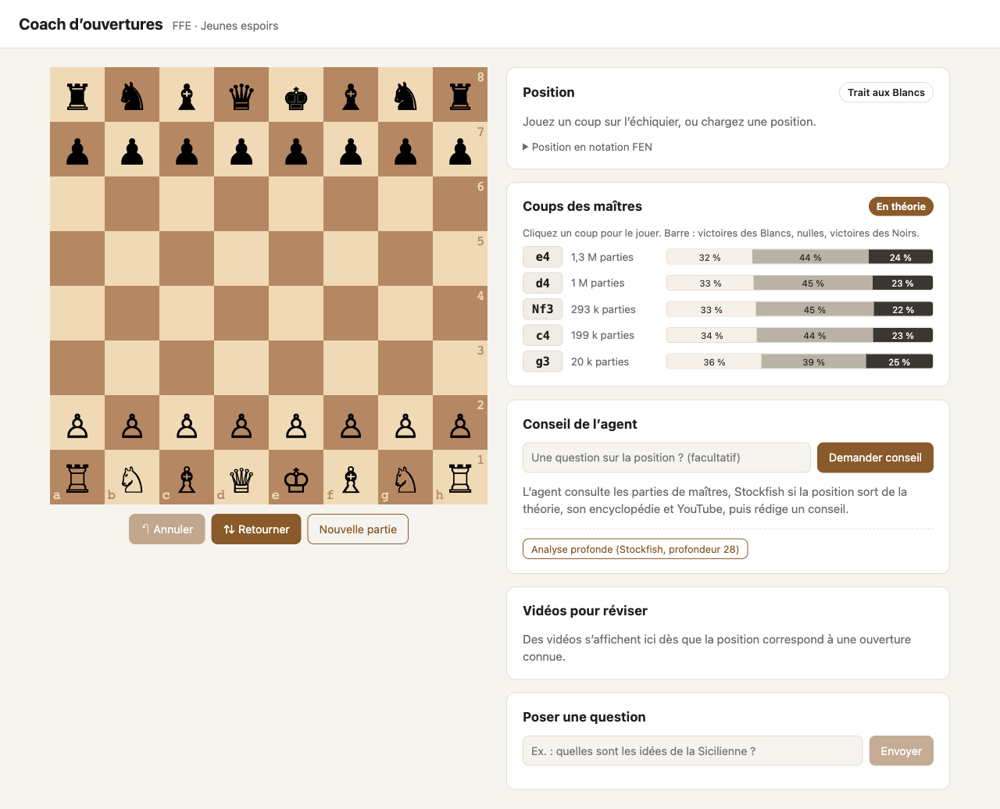

## 1. Vue d'ensemble

### 1.1 Architecture

```
Navigateur ─── Angular 21 (échiquier ngx-chess-board, panneau) ─── nginx :8080
                                                                     │ /api → backend
FastAPI :8000 ── Agent LangGraph (qwen3:14b via Ollama, sur l'hôte)
      │              │ registre de 7 outils
      │              ├── inspect_position        python-chess (local)
      │              ├── get_opening_theory      Lichess Opening Explorer
      │              ├── evaluate_position       Stockfish 17.1 (dans le conteneur)
      │              ├── search_opening_knowledge Milvus (RAG, 12 articles, 367 unités)
      │              ├── find_opening_videos     YouTube Data v3 (cache et quota MongoDB)
      │              └── start_/get_deep_analysis Stockfish en tâche de fond
      └── MongoDB (corpus brut, cache vidéos, quota) · Milvus (vecteurs) · journal de décision
```

### 1.2 Ce que voit l'utilisateur

| Zone | Contenu | Quand |
|---|---|---|
| Échiquier | pièces déplaçables, dernier coup et coups légaux surlignés ; boutons Annuler, Retourner, Nouvelle partie | toujours |
| Position | trait, statut (échec, mat, pat), coups joués ; FEN et chargement d'une position dans un dépliant | toujours |
| Coups des maîtres | nom de l'ouverture et code ECO, coups avec effectifs et barre de résultats, badge En théorie / Hors théorie | automatique à chaque position |
| Conseil de l'agent | réponse rédigée, évaluation Stockfish et lignes, extraits de l'encyclopédie, analyse profonde | à la demande |
| Vidéos pour réviser | miniatures, durée, vues, lien YouTube, lecteur intégré | automatique dès qu'une ouverture est nommée |
| Poser une question | conversation avec l'agent | à la demande |

## 2. L'échiquier et la position

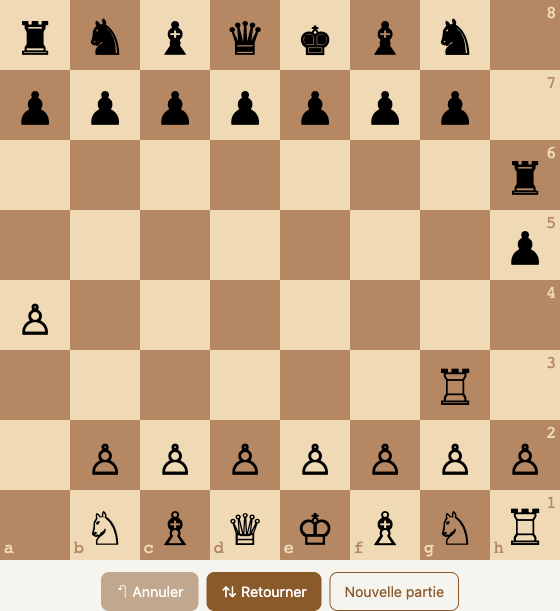

| Fonction | Détail |
|---|---|
| Jouer un coup | glisser-déposer ; chess.js valide la légalité (roque, prise en passant, promotion) ; un coup illégal est refusé et l'échiquier resynchronisé avec un message |
| Coups légaux et dernier coup | surlignés sur l'échiquier |
| Annuler | revient d'un coup ; la théorie revient aussitôt grâce au cache par position |
| Retourner | vue côté Noirs |
| Nouvelle partie | position initiale |
| Charger une FEN | dépliant « Position en notation FEN » : coller une FEN, validation immédiate ; une FEN invalide affiche la raison sans appeler l'API |
| Copier la FEN | bouton Copier, confirmation « Copiée ✓ » |
| Coups joués | notation algébrique par paires (1. e4 e5 …) |

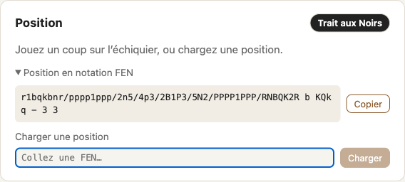

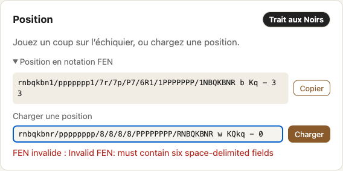

**Synchronisation.** La position est stockée à un seul endroit (`GameStateService`) ; tous
les appels à l'API en dérivent. Un coup joué pendant un chargement annule la requête en
cours ; une réponse arrivée pour une autre position est ignorée.

## 3. Coups des maîtres (Lichess)

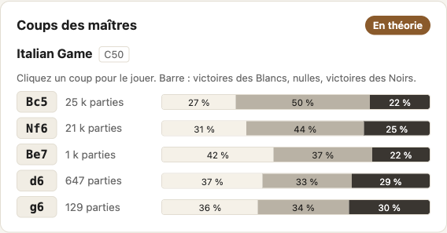

À chaque position, 400 ms après le dernier coup, l'application interroge l'Opening
Explorer de Lichess (base des parties de maîtres) par l'outil `get_opening_theory`.

| Élément | Signification |
|---|---|
| Nom et code ECO | « Italian Game · C50 » |
| Badge **En théorie** | au moins 20 parties de maîtres connues dans la position |
| Badge **Hors théorie** | position inconnue des maîtres : l'agent basculera sur Stockfish |
| Coup | cliquable : le joue sur l'échiquier, ce qui rafraîchit la carte |
| Parties | effectif en abrégé (25 k, 1,3 M) |
| Barre | part de victoires blanches, de nulles, de victoires noires, pourcentages inscrits |

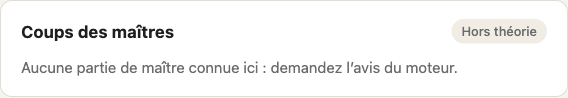

Un **cache par position** évite de rappeler Lichess quand on revient en arrière, et la
théorie ramenée par l'agent alimente ce cache. En cas d'erreur réseau, un message et un
bouton « Réessayer » apparaissent ; l'échiquier n'est jamais bloqué.

## 4. Conseil de l'agent

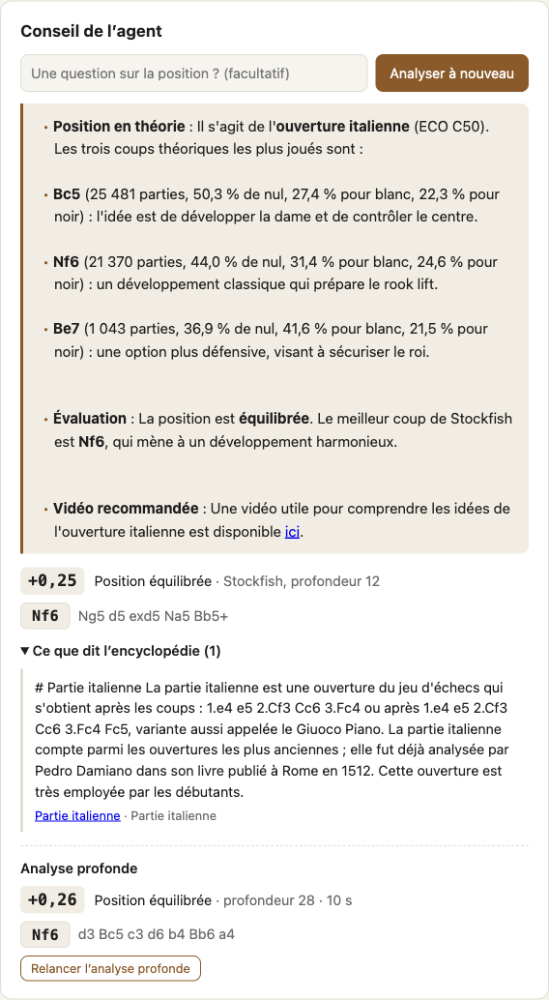

Le bouton **Demander conseil** (avec une question facultative, par exemple « pourquoi Fc5
est-il le coup principal ? ») lance le **parcours « position »** du graphe LangGraph, qui
suit la logique de l'énoncé : Lichess d'abord, Stockfish si la position sort de la théorie.

```
inspect_position ─► get_opening_theory ─┬─ en théorie ─► evaluate_position (profondeur 12)
                                        └─ hors théorie ─► evaluate_position (profondeur 18, 3 lignes)
                 ─► search_opening_knowledge ─► find_opening_videos ─► rédaction (qwen3:14b)
```

| Élément affiché | Source |
|---|---|
| Réponse rédigée (ouverture, coups principaux avec effectifs et résultats, évaluation, idée, vidéo) | modèle local qwen3:14b, à partir des seules données des outils |
| Score (+0,20), appréciation, profondeur, meilleure ligne cliquable | Stockfish 17.1 |
| « Ce que dit l'encyclopédie » : extraits avec source cliquable | RAG : recherche vectorielle dans les 12 articles |
| Vidéo recommandée | YouTube filtré (voir § 6) |
| Bandeau « Ce conseil porte sur une position précédente » | si l'échiquier a bougé depuis : les coups proposés deviennent inactifs, l'analyse se relance d'un clic |

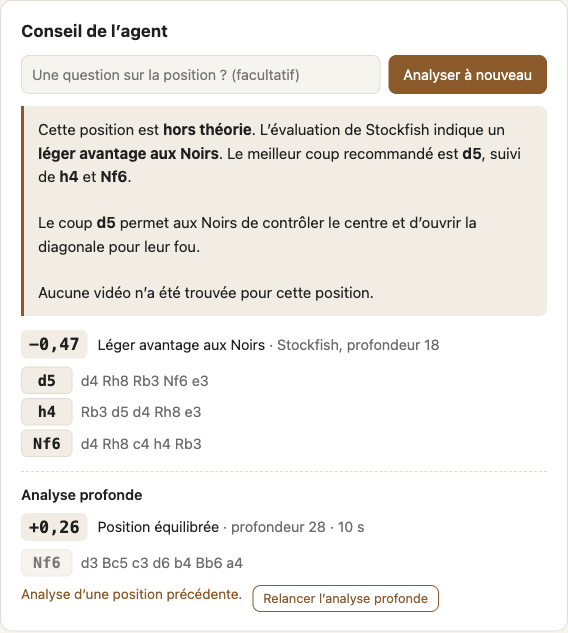

Le conseil prend 20 à 90 secondes avec le modèle local ; il est donc **à la demande**, jamais
automatique, et l'indicateur « L'agent réfléchit… » reste visible pendant ce temps.

### 4.1 Analyse profonde (outils différés)

Le bouton **Analyse profonde (Stockfish, profondeur 28)** illustre les deux outils
asynchrones : `start_deep_analysis` lance une tâche de fond côté serveur et renvoie un
ticket ; `get_deep_analysis` est interrogé toutes les deux secondes jusqu'à `done`. Le
résultat (score, appréciation, ligne principale, durée) s'affiche sous le conseil ; une
analyse est abandonnée côté front si la position change ; la même position à la même
profondeur ne relance pas le moteur (tâche idempotente).

## 5. Poser une question (parcours « question »)

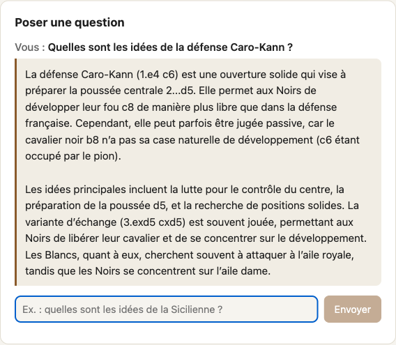

La carte **Poser une question** envoie une question libre à l'agent, qui **choisit
lui-même ses outils** par appel natif (sélection mesurée en phase 5 : 97 % d'outils corrects
sur 30 tâches avec qwen3:14b). « Quelles sont les idées de la Caro-Kann ? » déclenche une
recherche dans l'encyclopédie ; « Bonjour » n'appelle aucun outil ; une demande de vidéo
appelle YouTube ; une position collée dans la question appelle Lichess puis Stockfish.
Les échanges s'enchaînent dans la même session (regroupement des traces).

Le graphe applique un **budget** : au plus 3 tours d'outils ; la boucle de **recherche
multi-sauts** (phase 6) décompose une question en sous-questions dépendantes, reformule
quand une recherche ne ramène rien, et s'arrête à 3 recherches ou 6 000 tokens de contexte.

## 6. Vidéos pour réviser (YouTube)

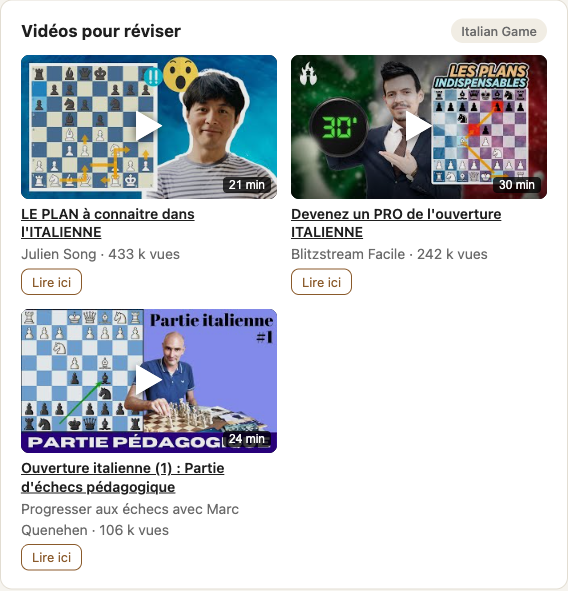

Dès que la théorie nomme une ouverture, la carte interroge `GET /videos/{famille}`.

| Étape côté serveur | Détail |
|---|---|
| Requêtes combinées | nom français (dictionnaire de 28 ouvertures) + mots-clés « échecs ouverture explication », puis nom anglais + « chess opening tutorial » |
| Détails | `videos.list` : durée, vues, likes, langue audio |
| Filtre qualité | 3 à 45 min, au moins 1 000 vues, titre pertinent, audio en français, intégrable, `safeSearch=strict` |
| Classement | langue demandée d'abord, puis vues |
| Cache | MongoDB, 7 jours, partagé entre l'agent et l'endpoint |
| Quota | compteur journalier (heure du Pacifique), réserve de 500 unités, refus avant l'appel Google ; 201 unités par ouverture non cachée |

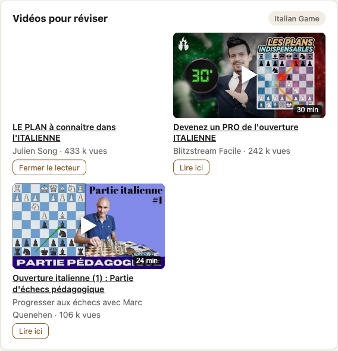

Chaque vidéo offre le **lien YouTube** et un **lecteur intégré** (`youtube-nocookie`)
ouvert à la demande. Mesure réelle sur les 10 ouvertures du corpus : 10 sur 10 avec vidéos,
29 vidéos retenues, 86 % des titres nomment l'ouverture, 100 % en français. Sans clé ou
quota épuisé, la carte affiche le message de l'API ; le reste fonctionne.

## 7. Les sept outils de l'agent

| Outil | Service | Ce qu'il renvoie | Résilience |
|---|---|---|---|
| `inspect_position` | python-chess (local) | validité, trait, coups légaux, matériel, phase | — |
| `get_opening_theory` | Lichess Opening Explorer | ouverture (ECO), coups avec effectifs et résultats, parties de référence, `in_theory` | délai 5 s, 3 tentatives, disjoncteur |
| `evaluate_position` | Stockfish 17.1 | score en centièmes de pion ou mat, appréciation, lignes principales | délai 10 s, 2 tentatives, disjoncteur ; un processus moteur partagé |
| `search_opening_knowledge` | Milvus + encodeur Qwen3-Embedding | passages de l'encyclopédie avec titre, section, source, score ; `found` | seuil 0,60 ; `model_loading` si l'encodeur n'est pas prêt |
| `find_opening_videos` | YouTube Data v3 | vidéos filtrées avec lien, lecteur, durée, vues ; requêtes ; `from_cache` ; quota du jour | délai 8 s, 2 tentatives (jamais sur quota), disjoncteur, cache 7 jours |
| `start_deep_analysis` | Stockfish en tâche de fond | ticket (`job_id`, délai conseillé) | idempotent par position et profondeur |
| `get_deep_analysis` | idem | état `pending` / `running` / `done` / `failed` et résultat | — |

Chaque outil est un **contrat** (`ToolSpec`) : entrée et sortie Pydantic, description
écrite pour le modèle (quand l'utiliser, quand ne pas l'utiliser, exemple), effets de bord
déclarés, idempotence, politique de résilience (délai, tentatives, disjoncteur) et
taxonomie d'erreurs (`input`, `transient`, `unavailable`) que l'agent sait interpréter.
Le détail est dans `docs/contrat-tools.md`.

## 8. L'encyclopédie d'ouvertures (RAG)

| Aspect | Réalisation |
|---|---|
| Corpus | 12 articles Wikipédia FR figés (Italienne, Espagnole, Sicilienne, Française, Caro-Kann, Scandinave, Gambit dame, Slave, Est-indienne, Anglaise, Deux cavaliers, Gambit Evans) avec métadonnées (date, version, service, confidentialité filtrée côté serveur) |
| Découpage | hiérarchique par type de contenu : texte en 256 tokens avec parents de 1 024, listes, parties une par unité ; fil d'Ariane ; résumés par phi4-mini en cache |
| Index | Milvus 2.6, 367 unités, vecteurs Qwen3-Embedding-0.6B (1 024 dimensions) |
| Mesures | rappel à 5 de 0,87 sur Réf-30 ; boucle agentique : rappel 0,87, 1,2 saut en moyenne, objectifs atteints (phase 7) |
| Décision par l'agent | l'agent décide d'appeler l'encyclopédie : 0 appel sur 6 questions hors sujet, 0 sur 6 relevant d'un autre outil (Décision-50) |

Les huit phases (socle, jeux de référence, RAG simple, comparaison des découpages,
enrichissement, retrieval décidé par l'agent, multi-sauts, évaluation) sont détaillées avec
leurs mesures dans `docs/outil-rag.md`.

## 9. Traces et observabilité

| Élément | Détail |
|---|---|
| Journal de décision | une ligne JSON par étape (décision, appel d'outil, réponse) : session, trace, outil, arguments, statut, durée, tokens, coût équivalent cloud, issue |
| OpenTelemetry | spans `p13.*` par étape ; identifiant de trace renvoyé dans chaque réponse de l'agent |
| Langfuse (optionnel) | export des mêmes spans par session ; profil Compose `tracing`, arrêté par défaut |
| Coût | modèles locaux : 0 € ; équivalent cloud calculé pour information (0,014 € pour les 30 questions de Réf-30) |

## 10. L'API

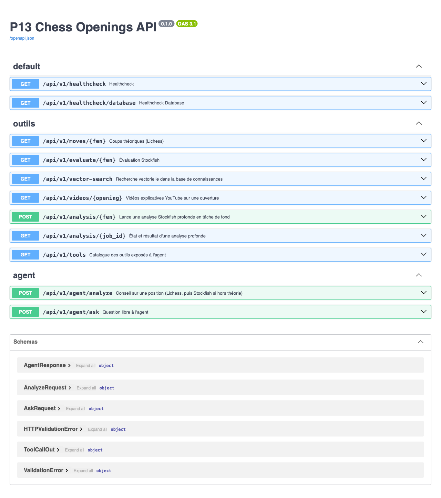

| Route | Rôle |
|---|---|
| `GET /api/v1/healthcheck`, `/healthcheck/database` | état de l'API et de MongoDB |
| `GET /api/v1/moves/{fen}` | coups théoriques Lichess |
| `GET /api/v1/evaluate/{fen}` | évaluation Stockfish |
| `GET /api/v1/vector-search` | recherche dans l'encyclopédie |
| `GET /api/v1/videos/{opening}` | vidéos filtrées (200 avec message si vide, 503 et `Retry-After` sur quota) |
| `POST /api/v1/analysis/{fen}`, `GET /api/v1/analysis/{job_id}` | analyse profonde différée (202 puis état) |
| `POST /api/v1/agent/analyze` | conseil complet sur une position, question facultative, session |
| `POST /api/v1/agent/ask` | question libre |
| `GET /api/v1/tools` | catalogue des outils tel que le modèle le voit |

Les erreurs d'outil sont traduites en HTTP : 422 pour une entrée invalide, 503 pour un
service indisponible (avec `Retry-After` quand il est connu), toujours avec `code`,
`message` et `hint`.

## 11. Conteneurs, installation et démonstration

| Service | Rôle | Port |
|---|---|---|
| `frontend` (nginx) | application Angular, relais `/api` vers le backend | 8080 |
| `backend` (FastAPI, Stockfish 17.1) | API et agent | 8001 |
| `mongodb` | corpus brut, cache vidéos, quota | 27017 |
| `milvus` (+ etcd, minio) | vecteurs du RAG | 19530 |
| `langfuse-*` (profil `tracing`) | traces, optionnel | 3000 |

Volumes persistants (MongoDB, Milvus, modèle d'embedding) vérifiés après `down` / `up`.
Installation fraîche testée depuis un clone vide : services sains en 112 s, ingestion du
corpus en 7 min 30 dans le conteneur, **`scripts/smoke.sh` 10 vérifications sur 10** (page,
backend, MongoDB, Lichess, Stockfish, Milvus, YouTube, analyse différée, conseil de l'agent,
question libre). Le README détaille prérequis, démarrage, positions de démonstration et
dépannage ; `docs/deploiement.md` consigne les tests.

## 12. Qualité et mesures

| Mesure | Valeur |
|---|---|
| Tests backend | 433, couverture 97 % (branches comprises), aucun appel réseau (respx, fixtures réelles) |
| Tests front | 33 (Vitest), API simulée |
| Vérification de bout en bout | 10 / 10 en conteneurs, depuis une installation fraîche |
| Sélection d'outil par l'agent (Tâches-30) | 97 % |
| Appels d'outil inutiles (Décision-50) | 0 / 6 hors sujet, 0 / 6 autre outil |
| Rappel du RAG (Réf-30) | 0,87 (simple et agentique), 1,2 saut |
| Vidéos (10 ouvertures) | 10 / 10, 86 % de titres nommant l'ouverture, 100 % en français |
| Résilience simulée (300 tours, 30 % de pannes) | 94 % d'appels réussis avec reprise, contre 72 % sans |

## 13. Limites connues et suite

| Limite | État |
|---|---|
| Le modèle local peut inventer l'« idée » d'un coup absente des données | documenté ; piste : ne rédiger l'idée que si un passage la contient |
| Quatre questions de Réf-30 restent introuvables (variantes nommées dans des listes) | piste : index lexical complémentaire |
| Tâches d'analyse profonde en mémoire | perdues au redémarrage du backend |
| Conseil en 20 à 90 s avec le modèle local | dépend de la machine ; un modèle cloud ramènerait à quelques secondes |
| Vidéos : recherche par ouverture, pas par position | objet de la note `docs/note-mcp-vision.md` (système étudié, non implémenté) |
| Mode « jouer contre l'agent » | décrit dans le processus, non implémenté |
